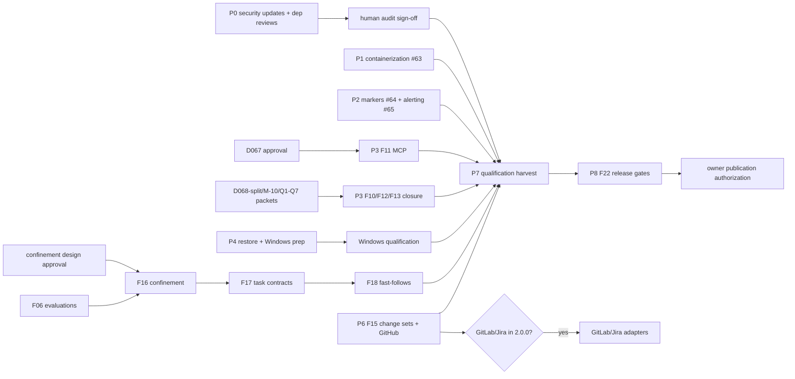

# Forge 2.0.0 — remaining work completion plan

Date: 2026-11-12 (America/Los_Angeles).
Status: **Proposed execution plan, in execution.** It closes no
requirement, records no approval, and authorizes no merge, publication,
or external contact. The
[2026-10-01 tranches](2026-10-01-roadmap-completion-tranches.md) remain the
canonical scope and the
[2026-10-25 owner dispositions](2026-10-25-owner-dispositions.md) remain
binding (D064, D068, F10 add-only export).

Revision 2 (2026-11-12): corrected the open-ticket inventory after a
ticket-number collision in the first fetch, recorded the branch cleanup,
and added the zip security findings. Ticket identifiers below were
re-verified against `veans list`.

## 1. Verified baseline (2026-11-12)

- `main` at `b4226bb` (PR #259, F08 POA&M completion, merged). CI on `main`
  green. Working tree clean except the user's `.veans.yml` / `.claude`
  settings — preserved, not committed.
- Board (veans, project 3 Forge): 70 tasks, 47 done, **23 open** —
  10 Doing, 9 In Review, 4 To-Do. Full inventory in §3.
- Open PRs are six Dependabot updates only: #260 zip 9.1.0→9.1.2,
  #261 hyper 1.11.1→1.12.0, #262 jsonschema 0.57.0→0.60.2, #263
  serde_json 1.0.151→1.0.154, #264 quick-xml 0.41.0→0.42.0, #265
  cargo-group docs bump. **All 25 open Dependabot alerts target retained
  evidence lockfiles** (`docs/dependency-reviews/2026-10-02/pr16*/Cargo.lock`,
  zip 8.6.0), not the shipping graph — root zip 9.1.0 is out of all five
  advisory ranges (verified via Dependabot API + `cargo audit` on main).
  Dismissal is a proposed owner action; the receipts stay immutable.
  The live `cargo audit` failures on main are pulldown-cmark
  RUSTSEC-2026-0414/0433 (wikilink-only, option never enabled) and rustix
  RUSTSEC-2026-0486 (INFO, via tempfile). P0 upgrades all three crates
  plus zip 9.1.2 hardening on `fix/p0-supply-chain-security`.
- Branch cleanup executed 2026-11-12 with user approval: deleted
  `codex/f07-poam-foundation`, `codex/f09-lossless-data-export`,
  `codex/f10-baseline-epoch-guard`, `codex/forge-linux-qualification`
  after verifying every deliverable is superseded on main (test
  supersets, byte-identical linux scripts, PR #222 merged). No unmerged
  worktrees exist anywhere in `~/repos`.
- Code present and merged: F04/F05/F19 workspace (browser assets,
  recovery, focus/a11y remediation), F07/F08 POA&M (`src/poam/`,
  `src/assessment_results/`), F09 overlay, F10 epochs + add-only
  reviewed-risk export, F12 queues (`src/review/`, wire v1–v3), F11 MCP
  worker (`src/mcp/`, seven tools, MCP 2026-07-28, v1 default + v2/v3
  development checkpoints), F06 suggestion pipeline (`src/suggest/`,
  recorded-response operation).
- **Not in the repo:** any external-workflow integration code (no
  change-set schema, no GitHub/GitLab/Jira adapter — `src/` has zero
  matches); confined local model execution (F16); the two complete
  suggestion task contracts (F17); suggestion review fast-follows (F18);
  container packaging (no Dockerfile/compose); SBOM, support matrix,
  support policy, release runbook.
- Supply chain: 370 `cargo-vet` exemptions in `supply-chain/config.toml`;
  audits/imports partial. Owner approved the October dependency decisions
  (PRs #160–164, tokio/toml updates); attributable human audit sign-off
  for the shipping graph is still open (F03).
- No November plan files existed in `docs/plans/` despite ticket
  references to `2026-11-06-*`; those references point at unmerged
  branch-local artifacts. This plan is the single consolidated successor.

## 2. What "remaining" actually means

Almost all Must-Have *code* for PRDs 055–064 is merged. The remainder
falls into five classes; the plan interleaves them so agent work never
idles behind human gates:

- **A — Agent-implementable now:** container packaging (#63); field-info
  markers/docs/examples (#64); review-due alerting (#65); F15 change
  sets + GitHub adapter (new ticket); F16–F18 after design approvals
  (new tickets); F11 conformance harness after D067; coverage tooling;
  decision packets; documentation reconciliation.
- **B — Owner decisions blocking code:** D067 (MCP discovery/threat
  model), D068 scope split (F12/F13; formerly mislabeled D069, which
  the 2026-10-02 packet uses for dependency policy), F10 Q1–Q7,
  F12 M-10/M-13/M-15,
  A11Y-C-1 fallback, F16 confinement design, GitLab/Jira scope (§4).
- **C — Human/physical gates:** real reviewers, pilots, AT/WCAG sessions,
  macOS/Windows hardware runs, independent-tool interop, security/privacy
  sign-off, dependency audit approval, publication authorization.
- **D — Supply chain:** six open Dependabot PRs (P0 security branch
  first), exemption burn-down, attributable audits (F03).
- **E — Release artifacts:** SBOM, support matrix/policy, runbook,
  rollback rehearsal, release CI, provenance (F22, no ticket yet).

Delivery rules from ticket #2 stay in force: isolated branches + draft
PRs, exact-head evidence, agents move work to In Review, humans/merge
hook close, merging/publication/contact need separate authorization.

## 3. Open-ticket inventory → phase (re-verified identifiers)

| Ticket | id | Title | Bucket | Phase | Remaining work |
|---|---|---|---|---|---|
| #2 | 1390 | Forge 2.0.0 umbrella | Doing | all | Coordination; create F15–F18/F22 child tickets when phases start |
| #5 | 1393 | F03 dependency audit | Doing | P0 | P0 security branch (pulldown-cmark/rustix/zip); #261–#265 reviews; exemption reconciliation; human sign-off |
| #6 | 1394 | F04 platform verification | Doing | P7 | macOS/Windows physical runs; container deployment evidence (#63); reconciliation |
| #7 | 1395 | F05 security & a11y | Doing | P7 | WCAG/AT sessions, real users, A11Y-C-1 disposition, security review |
| #8 | 1396 | F06 suggestion evaluation | Doing | P5/P7 | Authentic participant evaluations with pinned corpus |
| #17 | 1412 | F09 lossless overlay | In Review | P7 | Code complete (both children done); overlay contract records + independent interop + privacy/owner/pilot gates remain |
| #19 | 1414 | F10 epochs & risk handoff | Doing | P3 | Q1–Q7 owner answers; evidence reconciliation, likely no new code |
| #21 | 1416 | F12 portable queues | In Review | P3 | M-3 adapters, M-10 patches, M-13/M-15, S-1/S-2/S-4, D068, human gates |
| #23 | 1418 | F19 workspace Shoulds | Doing | P7 | Prerequisite delivered (#1419); remaining Should gates + #64/#65 children |
| #42 | 1437 | Source bundle restore | In Review | P4 | Capacity qualification delivered PR #278; Windows crash/rollback gate open (P7) |
| #44 | 1439 | F08 POA&M workflow | In Review | P7 | Human workflow/security/privacy gates (code merged via #259) |
| #55 | 1450 | F11 MCP core + agent eval | To-Do | P3 | Threat-model approval, two-client conformance, qualification |
| #56 | 1451 | F11 prereq discovery/threat model | Doing | P3 | D067 approval record; then unblocks #55 |
| #59 | 1454 | F13 collaborative review | Doing | P3 | Shares D068 with F12; quorum, workspace client |
| #63 | 1459 | Containerize CLI + workspace | In Review | P1 | Delivered PR #274; deployment evidence feeds F04 |
| #64 | 1460 | Field info markers/docs/examples | In Review | P2 | Delivered PR #277; WCAG/AT checks fold into P7 |
| #65 | 1472 | Due/overdue review alerting | In Review | P2 | Delivered PR #272; WCAG/AT checks fold into P7 |
| #66 | 1473 | Record 2026-10-25 owner dispositions | In Review | P3 | Close-ready: PR #252 merged (20f46ac) |
| #67 | 1474 | F08 asserted terminal states (D064) | In Review | P7 | Close-ready: PR #255 merged; human gates on #44 |
| #68 | 1475 | F10 additive epochs (S-4) | In Review | P3 | Close-ready: PR #256 merged; Q1–Q7 on #19 |
| #69 | 1476 | F10 add-only risk export (S-3) | In Review | P3 | Close-ready: PR #257 merged; Q1–Q7 on #19 |
| #70 | 1477 | Accept AR in forge validate | In Review | P3 | Close-ready: PR #253 merged; Q7 scope confirmation (no PRD 054 override occurred) |
| #71 | 1478 | Windows no-replace publication | In Review | P4 | Windows qualification; feeds M-15 decision |
| #72 | 1482 | F16 confined local execution | To-Do | P5 | Confinement design approval, then implementation |
| #73 | 1483 | F15 change sets + GitHub adapter | In Review | P6 | Phase 1 delivered PR #276; Phase 2 blocked on D5 dependency approval |
| #74 | 1484 | F17 both suggestion task contracts | To-Do | P5 | After F06/F16 |
| #75 | 1485 | F18 suggestion review fast-follows | To-Do | P5 | 066 S-2–S-4 after F17 |
| #76 | 1486 | F22 release gates | To-Do | P8 | Scaffolding delivered PR #269; owner approvals D7 + publication remain |

F15–F18 and F22 child tickets created under #2 on 2026-11-12
(#72–#76 above).
F20 (multi-source MCP) and F21 (cross-family quorum) are conditional
Shoulds whose `/2` and `/3` development checkpoints already exist in
`src/mcp/` and `src/review/`; qualification folds into P3.

## 4. Decision register (prepare packets; owner answers)

Each item gets a concrete proposal packet under `docs/plans/` with
options, a recommendation, and exact PRD citations. Nothing here is
pre-approved.

1. **D067 — F11 project discovery + threat model** (blocks #55 public
   implementation). Packet: current confined-roots discovery, the
   read-only threat model, MCP 2026-07-28 conformance plan, two-client
   choice. Recommendation: approve the implemented discovery model as-is;
   it already enforces disjoint confined roots and raw-file pins.
2. **D068 scope split — F12/F13** (relabelled: "D069" collides with the
   dependency-policy decision ID in the 2026-10-02 packet): the split
   is already bound by the recorded 2026-10-25 D068 disposition —
   verify by evidence, do not re-decide. Remaining M-3 adapters
   (057 impact, 063, 064, 066, clause-level 061) and S-1 interactive
   workspace client ordering per that disposition.
3. **D068 — quorum/separation minimum + snapshot vs reference** for
   F12/F13. Already recorded 2026-10-25; verify the merged `quorum_v3`
   implementation matches the disposition and close the ticket checkbox
   by evidence, not re-decision.
4. **F10 Q1–Q7** (ticket #19 last comment): export breadth for
   non-terminal histories, existing-plan targets, terminal baselines,
   reopen semantics, AR-in-`forge validate` (Q7, ticket #70). D064 +
   the 2026-10-25 add-only decision already answer most; recommendation:
   keep export "new planned work + add-only into existing plans", later
   transitions authored in `forge.poam/1`. **Q7 correction (verified):**
   PRD 054 excludes AR *generation* and AP/SSP-in-validate, not AR
   *validation* — PR #253 (merged 2026-10-26) added validation only, so
   the audit's "scope expansion" flag was an over-reading. Packet asks
   the owner to confirm AR validation is in scope (no override occurred)
   and optionally add a clarifying PRD 054 note.
5. **F12 M-10 patch contract** (PRD 068 M-10): proposed-edit envelope,
   target-hash binding, AC-5 wrong-hash rejection.
6. **F12 M-13 sensitive/excerpt export mode** and **M-15 Windows
   publication** (currently refused; #71 delivers the no-replace
   mechanism). Recommendation: M-13 explicit opt-in with conservative
   default retained; M-15 keep refusal until Windows qualification
   passes.
7. **A11Y-C-1 fallback disposition** (F05): remaining keyboard/AT
   fallback acceptance criteria.
8. **F16 confinement design**: sandbox mechanism per platform,
   verified executable bytes, descendant cleanup. No new dependency
   without approval (PRD 069).
9. **GitLab/Jira in 2.0.0?** PRD 065 explicitly lists them as follow-on,
   outside the MVP. No tickets exist; do not create them unless the
   owner confirms inclusion. Recommendation: defer; keep 2.0.0 finite.
10. **S-2 signed envelopes** (F12): identity/crypto design + dependency
    approval, or record as Won't for 2.0.0. Recommendation: Won't unless
    owner supplies the design; it is a Should, not a Must.

## 5. The plan — phases, order, parallelism

### P0 — Supply-chain security + board reconciliation (start now)
- Advance the P0 security branch (`fix/p0-supply-chain-security`):
  pulldown-cmark 0.13.6 + rustix 1.1.6 close the live `cargo audit`
  failures; zip 9.1.2 (#260) is defense-in-depth hardening. Proposed
  owner action: dismiss the 25 retained-evidence alerts (see
  `docs/plans/2026-11-12-supply-chain-security-decisions.md`). Then
  #261–#265 individually at immutable heads:
  exact old/new transitions, advisory scan, CI receipts, per-PR notes in
  `docs/dependency-reviews/2026-11-12/` following the 2026-10-02 packet
  conventions. jsonschema 0.57→0.60 passes behavioral checks;
  **quick-xml 0.41→0.42 is a breaking API change** (byte slices → &str,
  23 compile errors) — #264 must not merge as a bump; migration slice
  `feat/quick-xml-0.42-migration` supersedes it.
- Reconcile `supply-chain/` (370 exemptions): burn down what new audits
  cover; owner approval per update, as in the 2026-10-24 record.
- Post plan location on #2; create F15–F18/F22 child tickets only when
  their phases start. Attributable human audit sign-off stays a human
  gate; agent-assisted review never substitutes.
- Status 2026-11-12: security branch delivered as draft PR #266
  (head `05fc7ca`); review packet PR #267 (head `76c9671`, 73 evidence
  hashes independently re-verified); quick-xml migration PR #268
  (head `e5feba4`, tab-escape delta independently reproduced).
  Findings: #265 must close without merge (edits immutable receipts);
  #264 superseded by #268; all 47 exceptions past review-by, expiry
  2026-11-23 — renewal escalated (decision batch D1b). F15–F18/F22
  tickets created (#72–#76).

### P1 — Containerization (#63) — independent, start now
- Multi-stage Dockerfile (build + slim runtime), non-root user,
  documented volumes for project/workspace state, compose for the
  loopback workspace, offline-core invariant preserved (no outbound
  fetch at runtime beyond the explicitly launched workspace).
- Smoke evidence: build, `forge --version`, conversion of an example
  policy, workspace launch/health inside the container.
- DELIVERED 2026-11-12: draft PR #274 (head `6114a88`), #63 In Review.
  Digest-pinned multi-stage image (185 MB, uid 10001), host networking
  (bridge incompatible with loopback-peer/Host guards — design review
  in docs/container.md), /dev/tty-only passphrase. arm64 native + amd64
  QEMU evidence; real-Chrome unlock; conversion independently re-run
  in-container by coordinator. Limits: amd64 emulated, virtiofs needs
  named volume for state.
- Exit: #63 In Review; deployment evidence feeds F04 (#6).

### P2 — Workspace UX backlog (#64, #65) — after P1, independent of decisions
- #64: field-level info markers with documentation links and examples
  across workspace surfaces; reuse existing help/i18n patterns; verify
  in a real browser.
- #65: due/overdue review alerting driven by existing lifecycle dates;
  surface in workspace, never mutate governed artifacts or infer
  approval.
- Status 2026-11-12: BOTH DELIVERED. #65 → draft PR #272 (head
  `068f8d6`, pure projection + CLI + workspace badge; boundary tests
  re-run green). #64 → draft PR #277 (head `1883d1c`, 81-entry fieldHelp
  table, ARIA disclosure markers on all surfaces; Node 278/278,
  installed-Chrome v1/API2 marker checks pass, before/after screenshots;
  pre-existing writable-v1 driver timing race documented, proven on
  pristine main). Both In Review.
- Exit: both In Review; WCAG/AT checks fold into P7.

### P3 — Decision-gated completions (F10/F11/F12/F13)
- Decision packets DELIVERED: draft PR #270 (head `08115d7`,
  `docs/plans/2026-11-12-owner-decision-packets.md`); owner batch at
  `docs/plans/2026-11-12-owner-decision-batch.md`. D067 re-pin
  DELIVERED: draft PR #275 (head `428c53e`), durable reconstruction
  (sha256 `a15bac36…`, 36923 bytes, coordinator-recomputed); the
  original approved bytes were lost from /tmp — ratification must
  approve the new document fresh. "D069" relabelled D068 scope split
  (ID collision with dependency policy).
- F10 (#19, #68, #69, #70): Q1–Q7 reconciliation; expected outcome is
  evidence closure, not new code; #66 dispositions record merged via
  #259 — verify and move to close-ready.
- F11 (#56 → #55): after D067, audit the merged v1 worker against the
  approved threat model; build the two-independent-client conformance
  harness against MCP 2026-07-28 (`server/discover`, namespaced
  metadata, complete result typing); F20 `/2` checkpoint gates.
- F12/F13 (#21, #59): per the recorded D068 split + M-10 approval,
  remaining M-3 adapters, S-4
  supersession for Lifecycle `/2` and Authoring `/3`, M-13/M-15 per
  decisions; S-1 interactive client reuses workspace APIs; F21 `/3`
  quorum qualification.
- Status 2026-11-13: owner decisions recorded (PR #283); implementation
  batch DISPATCHED — F16 Unix confinement (feat/f16-unix-confinement),
  F12/F13 M-10+adapters (feat/f12-f13-m10-adapters), F11 conformance
  (feat/f11-conformance). MSRV CI job + F03 evidence note DELIVERED
  (PR #285, head `8390cad`, 1.88 proven locally, index re-pinned).
- Exit: tickets In Review with exact-head evidence; human exercises
  booked into P7.

### P4 — Restore + Windows follow-through (#42, #71)
- Staged-capacity follow-through: implement if code is missing,
  otherwise qualification evidence plan.
- Windows transaction/crash/rollback and no-replace publication
  qualification needs the Windows runner (P7 hardware); agent prepares
  fixtures and scripts now.
- DELIVERED 2026-11-12: draft PR #278 (head `e10386b`), #42 In Review.
  Evidence-not-code finding confirmed; 8 native capacity checks + 5/5
  robustness runs (10 MiB cap, 20 MiB shared-pool boundary, unresolved
  reservations, SIGKILL→restart durability). Restart race root-caused:
  SIGKILL during journal replace left transactions.next → permanent
  fail-closed; fixed by settling cleanup_state=verified before
  termination (flock theory disproved by 20-trial probe). Windows
  harness prepared, fails closed off-Windows; Windows gate stays OPEN.
- Exit: agent portion In Review; platform qualification tracked in P7.

### P5 — Suggestion track (F06 → F16 → F17 → F18) — longest chain
- F16/F17/F18 child tickets created 2026-11-12 (#72, #74, #75).
- F06 (#8): protocol DELIVERED (PR #271); **G0 values OWNER-APPROVED
  2026-11-13** (PR #284 proposal, approval record
  `2026-11-13-f06-g0-approval.md`). G0 preparation unblocked; authentic
  sessions remain human-only (recruitment, consent, facilitation,
  adjudication, evidence). Drafting-first; mapping execution deferred to
  F17. Live-model latency gate blocked on F16.
- F16 (#72): owner approved Unix-first 2026-11-13; implementation
  DISPATCHED (feat/f16-unix-confinement) — macOS sandbox-exec/Seatbelt +
  Linux Landlock+seccomp-BPF, no new deps, fail-closed, recorded-response
  intact; Windows refused pending separate approval.
- F17: both versioned task contracts (mapping context/preparation/
  destination/promotion; policy drafting), citations/assumptions,
  quarantine, proposed unapproved patches; regression gates.
- F18: 066 S-2–S-4 — evidence/impact batch ordering, source/candidate/
  diff workspace review, expired-input re-evaluation without approval
  transfer.
- Exit: each ticket In Review as delivered; evaluation gates in P7.

### P6 — F15 external workflows (#73) — schema first
- Connector-neutral change-set schema (deterministic, stable IDs,
  provenance, no secrets in manifests); contract fixture so other
  adapters can implement equivalent safety semantics (PRD 065).
- GitHub Issues reference adapter: explicit owner/repo allowlist,
  mandatory dry-run before apply, create/update/close-request, recorded
  remote identity, idempotent retries, reconciliation that never treats
  remote state as FORGE approval. Network boundary stays optional; core
  offline invariant untouched.
- New dependencies need approval first — reuse approved crates
  (`hyper` is approved for the workspace transport) before adding.
- Execution split (2026-11-12): **Phase 1 DELIVERED** — draft PR #276
  (head `1485f17`), #73 In Review. Change-set export + plan/apply/
  reconcile state machine + 11 contract fixtures + 2 CLI flows against
  the in-process fake; no new deps, zero outbound. Fixed 3 bugs in the
  prior work (PEM secret-guard case mismatch, clippy pedantic, CLI
  --config collision). Phase 2 (live GitHub HTTPS transport) blocked
  on owner approval of an HTTP-client dependency + auth/TLS design
  (PRD 065 Phasing; decision D5).
- GitLab/Jira only after decision 9 confirms inclusion.

### P7 — Qualification & evidence harvest (human-heavy, agent-prepared)
Agent prepares scripts, fixtures, protocols, and evidence templates;
humans execute and sign:
- F04 (#6): physical macOS + Windows launch/shutdown campaigns;
  container deployment evidence from P1; Linux fixed-tool Chrome
  re-verification.
- F05 (#7): WCAG/AT sessions, real-user evaluation, A11Y-C-1
  (decision 7), security review.
- F06/F11/F12: participant evaluations, two-client MCP conformance with
  real clients, AC-1..AC-6 team exercises, independent-tool interop
  (F09 #17), reviewer-authority checks.
- F08 (#44, #67): workflow/security/privacy gates on merged POA&M code.
- Measured coverage DONE 2026-11-12: 92.18% lines on main `7dc20f2`
  (`docs/plans/2026-11-12-coverage-baseline.json` + gzipped evidence).
- Goal-wide final documentation review; reconcile every ticket's
  evidence links to exact merged heads.

### P8 — F22 release gates (#76)
- Scaffolding DELIVERED: draft PR #269 (head `ab9268a`) — offline
  CycloneDX 1.6 SBOM generator (299 components, schema-validated 0
  errors, 14 tests), support matrix, PROPOSED support policy, runbook
  with owner-authorization stop, offline rollback rehearsal.
- Remaining: owner support-policy approval, publication authorization,
  real rollback rehearsal on release artifacts, MSRV CI verification.
- Reconcile dependency/schema/release provenance end to end.
- **Owner publication authorization is the only exit.** No agent action
  publishes 2.0.0.

### Dependency structure

Immediate parallel starts (no decisions needed): **P0, P1,
P2, P4 agent portion, and all decision packets** (P3 prep).
Serial chains: D067→F11; packets→F12/F13; F06 evals + design→F16→F17→F18;
everything→P7→P8.

## 6. Verification protocol (every slice)

- Branch from refreshed `origin/main`, draft PR, exact-head evidence.
- `cargo fmt --check`, `cargo clippy --all-targets -- -D warnings`,
  `cargo test`, `cargo test --test api_contract_validation`; supply-chain
  gates when dependencies move; `./scripts/ci-local.sh` before PR.
- Snapshot changes via `cargo insta review`; workspace changes verified
  in a real browser (installed Chrome), not just Node tests.
- New non-trivial logic ships with a regression test that catches a
  consumer-visible bug; no new crate without recorded approval.
- Tickets: description kept in sync (HTML task lists), significant
  decisions commented, delivered work → In Review, never self-closed.

## 7. Risks

- **Retained-evidence alerts masquerade as shipping risk.** The 25
  Dependabot alerts are zip 8.6.0 in immutable October receipts; the
  shipping graph's live audit failures are pulldown-cmark/rustix, fixed
  on the P0 branch. Do not edit the receipts to silence alerts.
- **Decision latency dominates.** Six packets gate most remaining code;
  batch them to the owner in one sitting rather than serially.
- **Human gates are the true critical path** (evaluations, AT sessions,
  hardware, audit sign-off). Book participants early; agent-prepared
  protocols reduce session time.
- **F16 confinement is the largest unknown** (platform sandboxing,
  descendant cleanup). Design packet must name the mechanism per OS
  before any implementation estimate is credible.
- **Scope creep via GitLab/Jira and Q7.** PRD 065 and PRD 054 exclusions
  stand unless the owner explicitly overrides; default is defer.
- **Stale ticket references** to unmerged `2026-11-06-*` plans: this
  document is the consolidated successor; update ticket links at P0.
